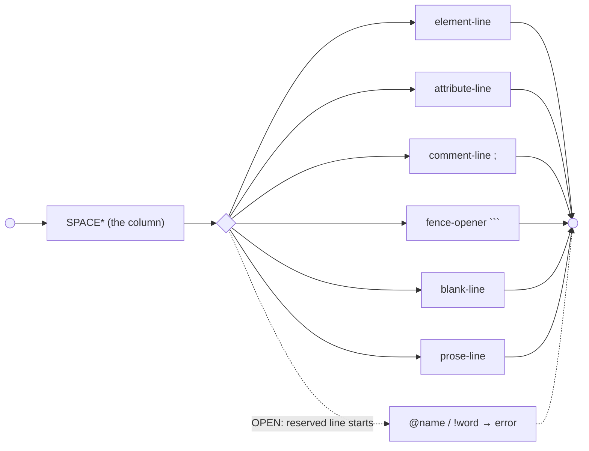
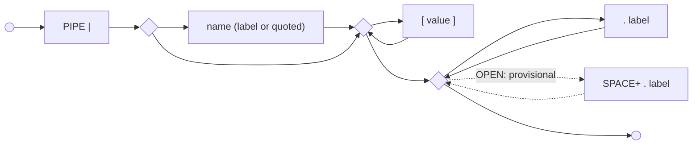
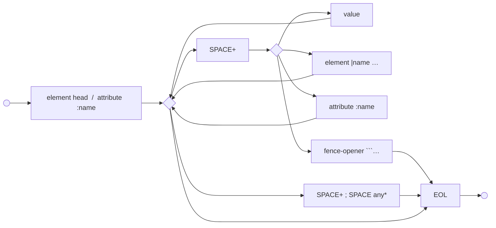
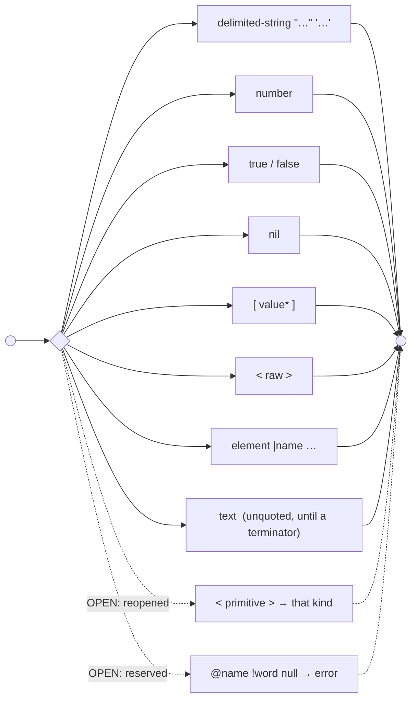
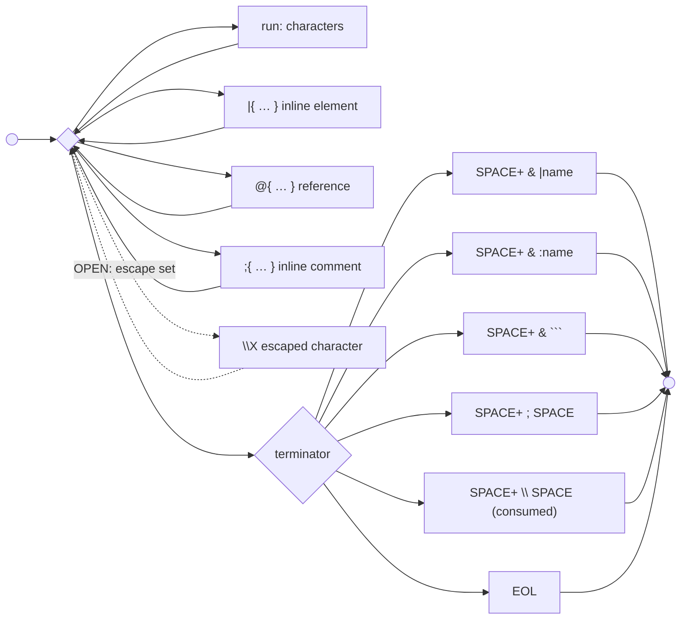
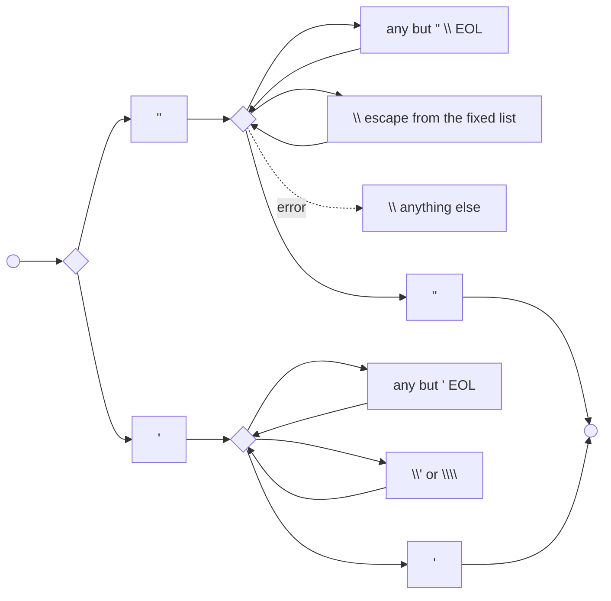
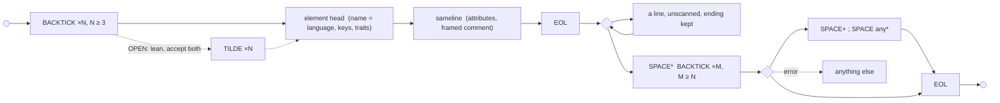
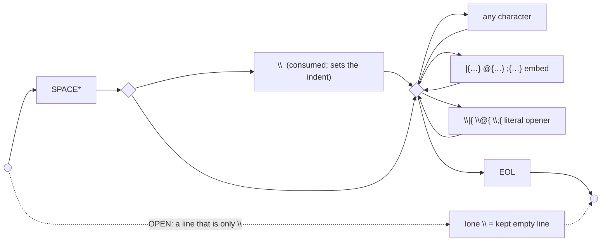
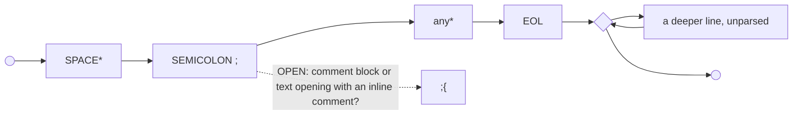

# Lite's grammar as railroad tracks (tentative, 2026-10-21)

*Drawn by the agent of session `014uHM6yNW767ksMmVtWt7Sn` from the cards as they stand, at Joseph's request. Each track is drawn twice. First a `flowchart LR`: `((start))` to `((end))`, a fork is a choice, a back-edge is a repeat; dashed edges and nodes marked **OPEN** are places no card settles or Joseph has reopened. Under it, the PEG it draws (`<-` defines, `/` ordered choice, `*` `+` `?` as usual, `&` and `!` lookahead) as mermaid's own railroad diagram, `railroad-peg-beta` (a beta diagram type, mermaid 11.16 and later; this note first said mermaid had none), put there the same day by session `016b7usvoaq7iyZwPtgrs2BD` at Joseph's request so the two drawings can be compared. The PEG was first written with `←` and `#` comments. The beta parser reads `<-` and a `;` after each rule, takes comments only as `%%` lines (each kept under the rule it annotates), and has no character classes or counts, so a class is drawn as a quoted terminal (`"[set]"`, `"[0-7]"`) or as the choice it lists, `BACKTICK{3,}` as three backticks and any more, and `BACKTICK{N,}` and `???` as quoted terminals (the PEG as first written is in commit `1c4887b`). Terminals are the named characters of [[def:characters]]. Nothing here is a ruling.*

*What a railroad can't show: indentation. Nesting is decided by each line's column against the open elements (the `rule:nesting` gap), so the tracks below are the **line layer**: what one line may hold, and what a value may be. Treat `INDENT`/`DEDENT` as Python does, outside the tracks.*

## 1. A line



```mermaid
railroad-peg-beta
line <- SPACE* (element-line / attribute-line / comment-line / fence-opener / blank-line / prose-line) ;
```

A TAB or other non-space whitespace in the column is an error ([[rule:column-shifting-whitespace-error]]); U+00A0 counts as a space with a default-off warning ([[rule:no-break-space-counts-as-space]]). Which of these a line is, is decided by its first content once ([[def:element-line]]); a line deeper than an established text left edge is prose whatever it starts with ([[rule:deeper-marker-lines-are-text]]).

## 2. An element's head



```mermaid
railroad-peg-beta
element <- PIPE name? key* trait* ;
name <- label / quoted-name ;
%% label characters: OPEN (labels discussion)
key <- '[' value ']' ;
%% [[rule:key-holds-a-value]]; escapes \\ \[ \]
trait <- (SPACE+)? '.' label ;
%% spaces before a trait: provisional, [[rule:traits-may-follow-spaces]]
```

One key or several is open (`rule:keys-and-traits` gap). An unquoted name can't begin with `.` while spaced traits stand.

## 3. The rest of an element or attribute line (sameline)



```mermaid
railroad-peg-beta
element-line <- element sameline ;
attribute-line <- attribute sameline ;
attribute <- COLON name ;
%% its value is the next item ([[rule:attribute-with-no-value-takes-next-value]])
sameline <- (SPACE+ item)* (SPACE+ framed-comment)? EOL ;
item <- element / attribute / fence-opener / value ;
framed-comment <- SEMICOLON SPACE (!EOL .)* ;
%% [[rule:framed-comments]]; attaches to the nearest item
```

What each item belongs to is not in the track: a value goes to the attribute still waiting for one, else to `$main` on an element line or stacks on an attribute line ([[rule:leftover-values]]); a bare `|name` after a finished value is a child at its column ([[rule:sameline-element-is-child]]); after an attribute waiting for a value it is that value ([[rule:element-after-attribute-with-no-value]]). An attribute with nothing after it is an error ([[rule:missing-value]]); an attribute directly after one is the reserved nested-attribute error ([[rule:attribute-after-attribute-with-no-value]]).

## 4. A value



```mermaid
railroad-peg-beta
value <- delimited-string / number / 'true' / 'false' / 'nil' / list / angle / element / text ;
number <- "???" ;
%% OPEN: the frozen bare set, `rule:bare-typing` gap
list <- '[' SPACE* (value (SPACE+ value)*)? SPACE* ']' ;
%% [[rule:list-items-whitespace-separated]]
angle <- '<' raw-interior '>' ;
%% matched brackets; escapes only \\ \< \> ([[rule:opaque-span-escapes]])
```

Bare `hello` (unquoted, no embed): a one-run «text» by the cards, a string of form bare by Joseph's 2026-10-20 sketch. OPEN, [[def:string]]. Under his reopening of `<…>`, `<3>` `<nil>` `<"hi">` would be values of those kinds and only non-matching interiors stay raw.

## 5. Unquoted text on a sameline, and its terminators



```mermaid
railroad-peg-beta
text <- piece+ &terminator ;
piece <- embed / escape / run ;
embed <- inline-element / reference / inline-comment ;
inline-element <- '|{' interior '}' ;
%% OPEN: interior undesigned (Joseph, 2026-10-09)
reference <- '@{' raw-interior '}' ;
inline-comment <- ';{' raw-interior '}' ;
run <- (!(embed / escape / terminator) .)+ ;
escape <- BACKSLASH "[set]" ;
%% OPEN: the set, [[rule:value-line-escapes]]
terminator <- SPACE+ &(PIPE / COLON / BACKTICK BACKTICK BACKTICK / SEMICOLON SPACE / BACKSLASH SPACE) / EOL ;
```

Spaces before a terminator are frame, not content ([[rule:space-before-text-end]]); the framed `\` is consumed ([[rule:framed-backslash-frame]]). A space followed by a reserved spelling (`@name`, `!word`) also ends the text and is the reserved error. Embeds never end a text ([[rule:embeds-in-text]]). Inside `|{…}` the closing `}` also ends it ([[rule:inline-element-value-end]]).

## 6. A delimited string ([[rule:strings-like-ruby]])



```mermaid
railroad-peg-beta
delimited-string <- double-quoted-string / single-quoted-string ;
double-quoted-string <- DOUBLE-QUOTE (dq-escape / dq-char)* DOUBLE-QUOTE ;
dq-char <- !(DOUBLE-QUOTE / BACKSLASH / EOL) . ;
dq-escape <- BACKSLASH ( (BACKSLASH / DOUBLE-QUOTE / SINGLE-QUOTE / "/" / "#" / "n" / "t" / "r" / "f" / "e") / "0" !DIGIT / "x" "[0-7]" HEX / "u{" hex-run (SPACE hex-run)* "}" / "u" HEX HEX HEX HEX ) ;
single-quoted-string <- SINGLE-QUOTE (sq-escape / sq-char)* SINGLE-QUOTE ;
sq-escape <- BACKSLASH (SINGLE-QUOTE / BACKSLASH) ;
sq-char <- !(SINGLE-QUOTE / EOL) . ;
```

(The productions are the ones drafted in [[def:delimited-string]]'s notes.) A raw EOL inside either is an error ([[rule:newline-in-string-is-error]]); nothing inside is UDON syntax.

## 7. A fence



```mermaid
railroad-peg-beta
fence-opener <- BACKTICK BACKTICK BACKTICK BACKTICK* element-head sameline EOL ;
%% [[rule:fence-opener-line]]; no later BACKTICK on the line
fence-body <- (!fence-closer line)* ;
%% never scanned ([[rule:fence-body-not-scanned]])
fence-closer <- SPACE* "BACKTICK ×N or more" (SPACE+ framed-comment)? EOL ;
%% N = the opener's count
```

The opener may sit anywhere structure can start, sameline included ([[rule:fence-anywhere-structure]]). The closer's column then takes part in nesting ([[rule:fence-closer-is-a-line]]). What the default handler accepts on the opening line (keys, `.exact`, a comment) is post-lexical ([[rule:fence-default-handler]]). `~~~` fences: Joseph leans to accept both, not yet carded.

## 8. A prose line ([[rule:prose-passes-through]])



```mermaid
railroad-peg-beta
prose-line <- SPACE* (BACKSLASH)? (embed / escaped-embed / .)* EOL ;
escaped-embed <- BACKSLASH ('|{' / '@{' / ';{') ;
```

A `;` or `@name` or `!word` partway along a prose line is text; only line starts are decided differently ([[rule:prose-line-start-reserved]]). Consecutive prose lines under one owner form one text ([[rule:text-lines-join]]); a `;` comment line between them splits it, or (Joseph's 2026-10-20 iolist remark) is a piece of it: OPEN, [[def:text]].

## 9. Comment lines



```mermaid
railroad-peg-beta
comment-line <- SPACE* SEMICOLON (!EOL .)* EOL deeper-line* ;
%% [[rule:comment-blocks]], [[rule:comment-block-owns-deeper-lines]]
```

## What the tracks exposed (for the cards, not decided here)

- Four productions have no body yet: `label` (characters), `number` (bare typing), `inline-element` interior, and the nesting that places lines. Those are the gap rows plus the labels and embeds discussions.
- `terminator` and `item` are the same list seen from two sides: everything that can start an item on a sameline is what ends unquoted text. Writing them separately risks drift; one card could define the list once ([[def:text-terminator]], [[def:marker]]).
- A framed comment appears in three tracks (sameline, fence closer, and implicitly the fence opener's sameline) with one shape; a `;{…}` appears in two (text piece, and maybe a line start). The `;{` at a line start is the one real ambiguity the tracks can't resolve.
